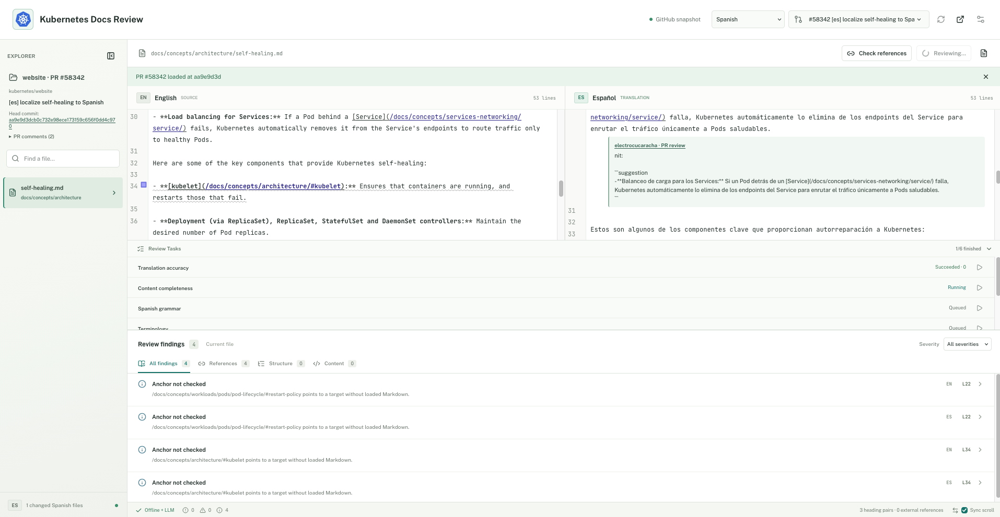

# Kubernetes Docs Review

<!-- markdown-link-check-disable-next-line -->

<!-- markdown-link-check-disable-next-line -->

[Documentation](https://electrocucaracha.github.io/k8s-docs-review-app/)
| [First review](docs/tutorials/first-review.md)
| [Contributing](CONTRIBUTING.md)

Kubernetes Docs Review is a local workspace for reviewing English sources and
Markdown translations in `kubernetes/website` pull requests. It pairs each
translation with its English source and combines deterministic checks with
optional AI-assisted review.

The app runs in a browser or as a native desktop app. Offline review requires
no backend, Azure account, or API key. Browser mode never writes to your
checkout; the desktop app can save translations in its app-managed checkout.

## How It Works

Choose a supported translation language, with Spanish selected by default,
then select an open PR with that language's label. The explorer loads its added
or modified Markdown files at the PR's exact revision. Inspect findings next to
the English source, edit the translation, and export it or save it from the
desktop app. AI review and checks against published Kubernetes documentation
are optional.

## Key Capabilities

- **Offline review checks** for links, anchors, structure, metadata, and
  untranslated text.
- **Optional LLM review** with Ollama, OpenAI, Anthropic, Gemini, and
  OpenAI-compatible providers.
- **Published-reference checks** for Kubernetes documentation URLs, with
  GitHub issue drafts for missing pages.
- **Browser and desktop workflows** for reviewing PRs, editing translations,
  and exporting or saving drafts.
